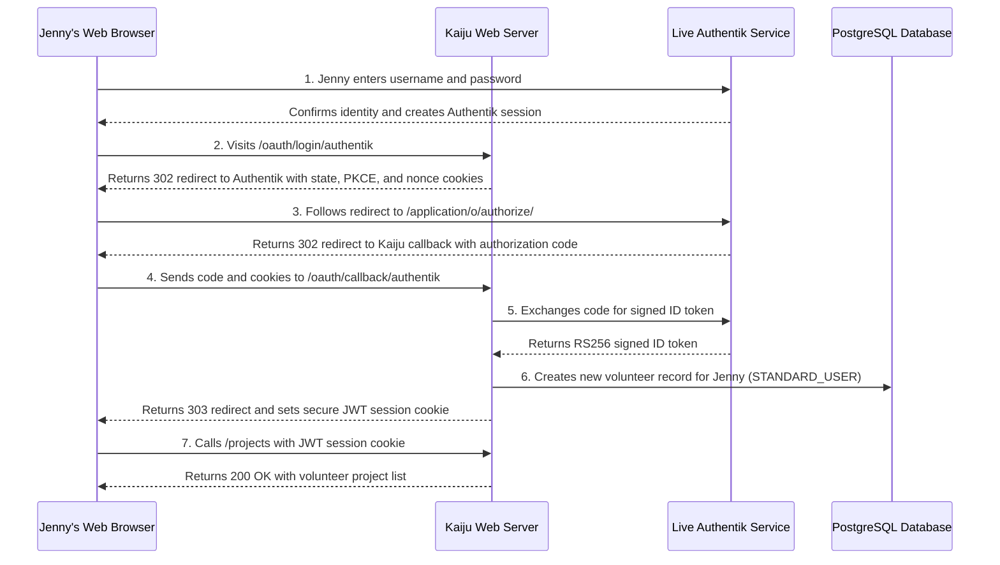

# OAuth2 Login & Callback Testing Guide

Guidelines for testing live browser-style login, token exchange, and newcomer account setup in Kaiju.

> [!NOTE]
> This guide explains how Kaiju tests real community logins from start to finish. It covers how we test the [OAuth 2.0](https://oauth.net/2/) flow, session cookies, and first-time account setup against a real identity provider without using fake mocks.

---

## 1. Why We Test Live Logins

When volunteers and coordinators log into Kaiju, they do not type passwords into Kaiju directly. Instead, they sign in through our identity service, [Authentik](https://goauthentik.io/). 

In early tests, newcomer account setup was tested by passing mock data directly to internal helper classes in computer memory. While that confirmed our data mapping rules worked, it completely skipped the web server front door.

Testing real HTTP web requests protects our community from real-world surprises:
* **Real Browser Steps**: When people log in on a phone or laptop, their browser follows redirects back and forth between Kaiju and Authentik. Our tests send real HTTP calls to ensure every redirect points to the right address.
* **Cookie Security**: Browsers rely on [HTTP Cookies](https://developer.mozilla.org/en-US/docs/Web/HTTP/Cookies) to track login state and remember who is signed in. Real HTTP tests ensure temporary login cookies are created safely and removed as soon as login finishes.
* **Zero Fake Mocks**: We test against a live Authentik service running in [Docker](https://www.docker.com/). If Authentik changes how it formats tokens or signs keys, our tests catch it immediately before any real user is affected.

---

## 2. The Login Journey: Jenny New

To understand how login testing works, consider the journey of a brand-new volunteer, Jenny New (`jenny.new@kaiju.local`). 

Jenny exists in our identity service, but she has never visited Kaiju before. She does not have a row in our [PostgreSQL](https://www.postgresql.org/) database.



### Step 1: Proving Identity in Authentik

Jenny signs in to Authentik with her email and password. Authentik gives her browser an authenticated session cookie.

### Step 2: Starting the Login at Kaiju

Jenny's browser visits `/oauth/login/authentik` on the Kaiju web server. Kaiju responds with a `302 Found` redirect sending her to Authentik's authorization screen. Along with this redirect, Kaiju attaches three temporary security cookies:
* `OAUTH2_STATE`: Protects against cross-site request attacks.
* `OAUTH2_PKCE`: Stores the code verifier for [Proof Key for Code Exchange (PKCE)](https://datatracker.ietf.org/doc/html/rfc7636).
* `OPENID_NONCE`: Protects [OpenID Connect](https://openid.net/developers/how-connect-works/) tokens against replay attacks.

### Step 3: Getting the Authorization Code

Jenny's browser follows the redirect to Authentik. Authentik sees her session cookie and immediately approves the request. It redirects her back to Kaiju at `/oauth/callback/authentik` with a one-time authorization code.

### Step 4 & 5: Kaiju Exchanges the Code for Tokens

Jenny's browser sends the code back to Kaiju along with her security cookies. Behind the scenes, the Kaiju server talks directly to Authentik to trade the authorization code and PKCE verifier for a signed [JSON Web Token (JWT)](https://jwt.io/introduction).

### Step 6: Creating the Account in the Database

Because Jenny is logging in for the first time, Kaiju reads her verified email address from the token. Kaiju creates a new volunteer record for her in PostgreSQL with the standard volunteer role (`STANDARD_USER`).

### Step 7: Welcome Home

Kaiju sets a secure `JWT` session cookie in Jenny's browser and redirects her to the home page (`303 See Other`). Her browser can now use this session cookie to look at volunteer projects, sign up for shifts, and view her profile.

---

## 3. How the Automated Tests Work

All live login tests live in [`AuthentikOidcIntegrationSpec`](../src/test/groovy/lol/pbu/kaiju/security/AuthentikOidcIntegrationSpec.groovy) and run with [Spock Framework](https://spockframework.org/):

* **Realistic Cookie Jar**: The test client tracks cookies across domains, handling multiple `Set-Cookie` headers and deleting expired cookies when `Max-Age=0` is sent.
* **Testing HTTP Status Codes**: The test does not let the HTTP client follow redirects automatically. Instead, it inspects each `302 Found` and `303 See Other` response directly to verify redirect targets and query parameters.
* **Database Verification**: After the callback succeeds, the test queries PostgreSQL directly using `UserRepository` to prove that Jenny's record was created with the correct email, role, and permissions.
* **Session Cookie Check**: The test uses the received `JWT` cookie to call protected endpoints (like `/projects`). This proves that [Micronaut Security](https://micronaut-projects.github.io/micronaut-security/latest/guide/) accepts the cookie without needing any special test headers or bearer tokens.
* **Automatic Cleanup**: When the test finishes, Jenny's newly created account is removed from PostgreSQL so future test runs start with a clean slate.

---

## 4. Running the Tests Locally

To run the OAuth2 integration test suite against the local Docker containers:

```bash
./gradlew test --tests "lol.pbu.kaiju.security.AuthentikOidcIntegrationSpec"
```

To run the fast mapper unit tests:

```bash
./gradlew test --tests "lol.pbu.kaiju.security.AuthentikAuthenticationMapperSpec"
```
