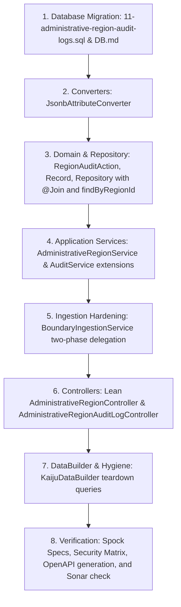

# Implementation Plan: GitHub Issue #80 (Architect-Approved)

**Title**: Audit Integrity: Add immutable audit logging for AdministrativeRegion mutations  
**Milestone**: 0.0.6  
**Issue Link**: [Issue #80](https://github.com/pbu-projects/Kaiju/issues/80)  
**Status**: Approved with Round 2 Architectural Refinements

---

## 1. Overview and Value

Administrative regions set geographic boundaries for volunteer work, jurisdictions, and project approvals. Today, when an administrator creates, edits, removes, or imports boundaries for a region, the database changes in place without recording who made the change or what previous boundary was replaced.

This plan adds an immutable audit log for all administrative region changes. Every create, edit, delete, and external boundary import will record:
- Who took the action (the authenticated user).
- What action occurred (`CREATE`, `UPDATE`, `DELETE`, or `BOUNDARY_INGEST`).
- When the action occurred (UTC timestamp).
- Helpful details in a structured JSON column (such as external source URLs, vertex counts, and reduction percentages).

All database operations and audit records execute within atomic transaction boundaries to ensure complete data integrity.

---

## 2. Architecture & Design Decisions

### 2.1 Database Schema (`11-administrative-region-audit-logs.sql`)

Create the new migration script in `database/init/11-administrative-region-audit-logs.sql` following Flyway naming conventions:

```sql
CREATE TABLE administrative_region_audit_logs
(
    id         UUID PRIMARY KEY DEFAULT gen_random_uuid(),
    region_id  UUID        NOT NULL,
    actor_id   UUID        NOT NULL REFERENCES users (id),
    action     VARCHAR(50) NOT NULL CHECK (
        action IN ('CREATE', 'UPDATE', 'DELETE', 'BOUNDARY_INGEST')
    ),
    metadata   JSONB,
    created_at TIMESTAMPTZ      DEFAULT NOW()
);

CREATE INDEX idx_admin_region_audit_logs_region ON administrative_region_audit_logs (region_id, created_at);
CREATE INDEX idx_admin_region_audit_logs_actor ON administrative_region_audit_logs (actor_id);
```

#### Key Schema Decision: Foreign Key on `region_id`
In `administrative_region_audit_logs`, `region_id` stores the region UUID without an `ON DELETE CASCADE` foreign key reference to `administrative_regions(id)`. 
- **Reason**: When an administrative region is deleted, an immutable audit log must preserve the history of who deleted the region and what was removed. A cascade delete would erase the audit trail, while a restrict constraint would block region deletions.
- `actor_id` references `users(id)` matching `project_audit_logs`.

---

### 2.2 PostgreSQL JSONB Attribute Converter

Following the pattern established by `JtsPolygonConverter.java`, create a compile-time `AttributeConverter` in `lol.pbu.kaiju.converter` to bridge Java `String` payloads and PostgreSQL `PGobject` with `jsonb` type. This avoids runtime JDBC type mismatch exceptions:

```java
package lol.pbu.kaiju.converter;

import io.micronaut.core.convert.ConversionContext;
import io.micronaut.data.model.runtime.convert.AttributeConverter;
import jakarta.inject.Singleton;
import org.postgresql.util.PGobject;

import java.sql.SQLException;

@Singleton
public class JsonbAttributeConverter implements AttributeConverter<String, PGobject> {

    @Override
    public PGobject convertToPersistedValue(String entityValue, ConversionContext context) {
        if (entityValue == null) {
            return null;
        }
        PGobject pg = new PGobject();
        pg.setType("jsonb");
        try {
            pg.setValue(entityValue);
            return pg;
        } catch (SQLException e) {
            context.reject(e);
            return null;
        }
    }

    @Override
    public String convertToEntityValue(PGobject persistedValue, ConversionContext context) {
        if (persistedValue == null) {
            return null;
        }
        return persistedValue.getValue();
    }
}
```

---

### 2.3 Action Enumeration: `RegionAuditAction`

Create a concise enum in `lol.pbu.kaiju.model`:

```java
package lol.pbu.kaiju.model;

import io.micronaut.serde.annotation.Serdeable;

@Serdeable
public enum RegionAuditAction {
    CREATE,
    UPDATE,
    DELETE,
    BOUNDARY_INGEST
}
```

---

### 2.4 Domain Entity: `AdministrativeRegionAuditLog`

Create the domain record in `lol.pbu.kaiju.domain`:

```java
package lol.pbu.kaiju.domain;

import io.micronaut.core.annotation.Nullable;
import io.micronaut.data.annotation.GeneratedValue;
import io.micronaut.data.annotation.Id;
import io.micronaut.data.annotation.MappedEntity;
import io.micronaut.data.annotation.MappedProperty;
import io.micronaut.data.annotation.Relation;
import io.micronaut.data.annotation.TypeDef;
import io.micronaut.data.model.DataType;
import io.micronaut.serde.annotation.Serdeable;
import jakarta.validation.constraints.NotNull;
import lol.pbu.kaiju.converter.JsonbAttributeConverter;
import lol.pbu.kaiju.model.RegionAuditAction;

import java.time.OffsetDateTime;
import java.util.UUID;

import static io.micronaut.data.annotation.Relation.Kind.MANY_TO_ONE;

@Serdeable
@MappedEntity("administrative_region_audit_logs")
public record AdministrativeRegionAuditLog(
        @Id
        @GeneratedValue
        UUID id,

        @NotNull(message = "Audit log region ID is required.")
        UUID regionId,

        @Relation(MANY_TO_ONE)
        @MappedProperty("actor_id")
        @NotNull(message = "Audit log actor is required.")
        User actor,

        @NotNull(message = "Audit log action is required.")
        RegionAuditAction action,

        @Nullable
        @TypeDef(type = DataType.OBJECT, converter = JsonbAttributeConverter.class)
        String metadata,

        OffsetDateTime createdAt
) {
    public AdministrativeRegionAuditLog withId(@NotNull UUID newId) {
        return new AdministrativeRegionAuditLog(
                newId,
                this.regionId(),
                this.actor(),
                this.action(),
                this.metadata(),
                this.createdAt()
        );
    }
}
```

---

### 2.5 Data Repository: `AdministrativeRegionAuditLogRepository`

Declare explicit `@Join("actor")` annotations on `findAll`, `findById`, and `findByRegionId` to prevent unpopulated relations and broken cursored pagination in Micronaut Data JDBC:

```java
package lol.pbu.kaiju.repository;

import io.micronaut.data.annotation.Join;
import io.micronaut.data.jdbc.annotation.JdbcRepository;
import io.micronaut.data.model.CursoredPage;
import io.micronaut.data.model.CursoredPageable;
import io.micronaut.data.repository.PageableRepository;
import lol.pbu.kaiju.domain.AdministrativeRegionAuditLog;
import org.jspecify.annotations.NonNull;

import java.util.Optional;
import java.util.UUID;

import static io.micronaut.data.model.query.builder.sql.Dialect.POSTGRES;

@JdbcRepository(dialect = POSTGRES)
public interface AdministrativeRegionAuditLogRepository
        extends PageableRepository<AdministrativeRegionAuditLog, UUID> {

    @NonNull
    @Join("actor")
    CursoredPage<AdministrativeRegionAuditLog> findAll(@NonNull CursoredPageable pageable);

    @NonNull
    @Join("actor")
    CursoredPage<AdministrativeRegionAuditLog> findByRegionId(@NonNull UUID regionId, @NonNull CursoredPageable pageable);

    @NonNull
    @Join("actor")
    Optional<AdministrativeRegionAuditLog> findById(@NonNull UUID id);

    long removeById(@NonNull UUID id);
}
```

---

### 2.6 Application Service Layer (`AdministrativeRegionService`)

In accordance with architectural principles established in Release 0.0.5 (Issues #54 and #65), all multi-entity mutations, boundary validations, and audit log writes must execute within transactional service boundaries. Controllers remain lean HTTP adaptors.

#### Service Interface
Create `lol.pbu.kaiju.service.AdministrativeRegionService`:

```java
package lol.pbu.kaiju.service;

import io.micronaut.data.model.CursoredPage;
import io.micronaut.data.model.CursoredPageable;
import lol.pbu.kaiju.domain.AdministrativeRegion;
import lol.pbu.kaiju.dto.CreateAdministrativeRegionCommand;
import lol.pbu.kaiju.dto.IngestBoundaryResponse;
import lol.pbu.kaiju.dto.UpdateAdministrativeRegionCommand;
import org.jspecify.annotations.NonNull;

import java.util.Optional;
import java.util.UUID;

public interface AdministrativeRegionService {

    @NonNull
    CursoredPage<AdministrativeRegion> getAdministrativeRegions(@NonNull CursoredPageable pageable);

    @NonNull
    Optional<AdministrativeRegion> getAdministrativeRegionById(@NonNull UUID id);

    @NonNull
    AdministrativeRegion createAdministrativeRegion(@NonNull CreateAdministrativeRegionCommand command, @NonNull UUID actorUserId);

    @NonNull
    AdministrativeRegion updateAdministrativeRegion(@NonNull UUID id, @NonNull UpdateAdministrativeRegionCommand command, @NonNull UUID actorUserId);

    void deleteAdministrativeRegion(@NonNull UUID id, @NonNull UUID actorUserId);

    @NonNull
    IngestBoundaryResponse applyIngestedBoundary(
            @NonNull UUID regionId,
            @NonNull String geomJson,
            double tolerance,
            @NonNull String sourceUrl,
            @NonNull UUID actorUserId
    );
}
```

#### Service Implementation Guardrails
`AdministrativeRegionServiceImpl` enforces domain guardrails within `@Transactional` methods:
1. **Cycle Prevention**: A region cannot be its own parent (`id.equals(command.parentRegionId())` throws HTTP 400).
2. **Parent Region Existence**: When `parentRegionId` is provided, the parent must exist in `administrative_regions` (throws HTTP 400 if missing).
3. **Geometry Validity**: `polygon.isValid()` verifies topological validity before persistence (throws HTTP 422 if invalid).
4. **Audit Consistency**: The audit entry is created and stored inside the same transaction. If an error occurs, the entire transaction rolls back.

```java
@Singleton
public class AdministrativeRegionServiceImpl implements AdministrativeRegionService {

    private final AdministrativeRegionRepository regionRepository;
    private final UserRepository userRepository;
    private final SpatialMappingService spatialMappingService;
    private final AuditService auditService;
    private final JdbcOperations jdbcOperations;
    private final ObjectMapper objectMapper;

    // Constructors...

    @Override
    @Transactional
    @NonNull
    public AdministrativeRegion createAdministrativeRegion(@NonNull CreateAdministrativeRegionCommand command, @NonNull UUID actorUserId) {
        User actor = userRepository.findById(actorUserId)
                .orElseThrow(() -> new HttpStatusException(HttpStatus.UNAUTHORIZED, "Actor user not found"));

        if (command.parentRegionId() != null && !regionRepository.existsById(command.parentRegionId())) {
            throw new HttpStatusException(HttpStatus.BAD_REQUEST, "Parent administrative region does not exist");
        }

        Polygon polygon = spatialMappingService.toPolygon(command.coordinates());
        if (!polygon.isValid()) {
            throw new HttpStatusException(HttpStatus.UNPROCESSABLE_ENTITY, "Region geometry is topologically invalid");
        }

        AdministrativeRegion region = new AdministrativeRegion(
                null,
                command.name(),
                command.parentRegionId(),
                polygon
        );
        AdministrativeRegion saved = regionRepository.save(region);

        String metadata = buildMetadata(Map.of("name", saved.name()));
        auditService.recordAdministrativeRegionAudit(saved.id(), actor, RegionAuditAction.CREATE, metadata);
        return saved;
    }

    @Override
    @Transactional
    @NonNull
    public AdministrativeRegion updateAdministrativeRegion(@NonNull UUID id, @NonNull UpdateAdministrativeRegionCommand command, @NonNull UUID actorUserId) {
        User actor = userRepository.findById(actorUserId)
                .orElseThrow(() -> new HttpStatusException(HttpStatus.UNAUTHORIZED, "Actor user not found"));

        if (command.parentRegionId() != null && id.equals(command.parentRegionId())) {
            throw new HttpStatusException(HttpStatus.BAD_REQUEST, "An administrative region cannot be its own parent");
        }

        if (command.parentRegionId() != null && !regionRepository.existsById(command.parentRegionId())) {
            throw new HttpStatusException(HttpStatus.BAD_REQUEST, "Parent administrative region does not exist");
        }

        AdministrativeRegion existing = regionRepository.findById(id)
                .orElseThrow(() -> new HttpStatusException(HttpStatus.NOT_FOUND, "Administrative region not found"));

        Polygon polygon = spatialMappingService.toPolygon(command.coordinates());
        if (!polygon.isValid()) {
            throw new HttpStatusException(HttpStatus.UNPROCESSABLE_ENTITY, "Region geometry is topologically invalid");
        }

        AdministrativeRegion updated = new AdministrativeRegion(
                id,
                command.name(),
                command.parentRegionId(),
                polygon
        );
        AdministrativeRegion saved = regionRepository.update(updated);

        String metadata = buildMetadata(Map.of("previousName", existing.name(), "newName", saved.name()));
        auditService.recordAdministrativeRegionAudit(id, actor, RegionAuditAction.UPDATE, metadata);
        return saved;
    }

    @Override
    @Transactional
    public void deleteAdministrativeRegion(@NonNull UUID id, @NonNull UUID actorUserId) {
        User actor = userRepository.findById(actorUserId)
                .orElseThrow(() -> new HttpStatusException(HttpStatus.UNAUTHORIZED, "Actor user not found"));

        AdministrativeRegion existing = regionRepository.findById(id)
                .orElseThrow(() -> new HttpStatusException(HttpStatus.NOT_FOUND, "Administrative region not found"));

        String metadata = buildMetadata(Map.of("deletedName", existing.name()));
        auditService.recordAdministrativeRegionAudit(id, actor, RegionAuditAction.DELETE, metadata);

        long deleted = regionRepository.removeById(id);
        if (deleted == 0) {
            throw new HttpStatusException(HttpStatus.NOT_FOUND, "Administrative region not found");
        }
    }

    @Override
    @Transactional
    @NonNull
    public IngestBoundaryResponse applyIngestedBoundary(
            @NonNull UUID regionId,
            @NonNull String geomJson,
            double tolerance,
            @NonNull String sourceUrl,
            @NonNull UUID actorUserId
    ) {
        User actor = userRepository.findById(actorUserId)
                .orElseThrow(() -> new HttpStatusException(HttpStatus.UNAUTHORIZED, "Actor user not found"));

        IngestBoundaryResponse response = executeBoundaryUpdate(regionId, geomJson, tolerance);

        String metadata = buildMetadata(Map.of(
                "sourceUrl", sourceUrl,
                "tolerance", tolerance,
                "origPoints", response.origPoints(),
                "simpPoints", response.simpPoints(),
                "reductionRatio", response.reductionRatio()
        ));
        auditService.recordAdministrativeRegionAudit(regionId, actor, RegionAuditAction.BOUNDARY_INGEST, metadata);

        return response;
    }
}
```

---

### 2.7 Boundary Ingestion: Bean Boundary Delegation

To avoid the AOP self-invocation trap and protect the HikariCP connection pool:
1. **Phase 1 (Non-Transactional Network & Geometry Parsing)** in `BoundaryIngestionService`:
   - Validate URL syntax, host, and path prefix.
   - Fetch remote GeoJSON payload over HTTP without holding an active database transaction.
   - Parse GeoJSON and validate closed linear rings with JTS.
2. **Phase 2 (Transactional PostGIS Update & Audit Recording)**:
   - `BoundaryIngestionService` invokes `administrativeRegionService.applyIngestedBoundary(regionId, geomJson, tolerance, command.sourceUrl(), actorUserId)`.
   - The method crosses bean boundaries, engaging Micronaut's `TransactionInterceptor`.
   - The PostGIS update and the `BOUNDARY_INGEST` audit entry commit together atomically.

---

### 2.8 Controller Layer & Security Bindings

#### 1. `AdministrativeRegionController`
- Delegates entirely to `AdministrativeRegionService` and `BoundaryIngestionService`.
- Binds native Micronaut `Authentication authentication`.
- Keeps controller methods clean and concise:

```java
@Secured({SYSTEM_ADMIN_CLAIM, REGION_MANAGE_CLAIM})
@Post
public AdministrativeRegion addAdministrativeRegion(
        @Valid @Body CreateAdministrativeRegionCommand command,
        @NonNull Authentication authentication
) {
    UUID actorUserId = UUID.fromString(authentication.getName());
    return administrativeRegionService.createAdministrativeRegion(command, actorUserId);
}

@Secured({SYSTEM_ADMIN_CLAIM, REGION_MANAGE_CLAIM})
@Put("/{id}")
public AdministrativeRegion updateAdministrativeRegion(
        @PathVariable UUID id,
        @Valid @Body UpdateAdministrativeRegionCommand command,
        @NonNull Authentication authentication
) {
    UUID actorUserId = UUID.fromString(authentication.getName());
    return administrativeRegionService.updateAdministrativeRegion(id, command, actorUserId);
}

@Secured({SYSTEM_ADMIN_CLAIM, REGION_MANAGE_CLAIM})
@Delete("/{id}")
public void deleteAdministrativeRegion(
        @PathVariable UUID id,
        @NonNull Authentication authentication
) {
    UUID actorUserId = UUID.fromString(authentication.getName());
    administrativeRegionService.deleteAdministrativeRegion(id, actorUserId);
}

@Secured(SYSTEM_ADMIN_CLAIM)
@Post("/{id}/boundary/ingest")
public IngestBoundaryResponse ingestBoundary(
        @PathVariable UUID id,
        @Valid @Body IngestBoundaryCommand command,
        @NonNull Authentication authentication
) {
    UUID actorUserId = UUID.fromString(authentication.getName());
    return boundaryIngestionService.ingestBoundary(id, command, actorUserId);
}
```

#### 2. `AdministrativeRegionAuditLogController`
- Path: `/administrative-region-audit-logs`.
- Supports optional `regionId` query parameter matching the index `idx_admin_region_audit_logs_region`.
- Strictly read-only (`GET` only). Any `POST`, `PUT`, or `DELETE` attempt returns HTTP 405 Method Not Allowed.

```java
@ExecuteOn(TaskExecutors.VIRTUAL)
@Secured(IS_AUTHENTICATED)
@Controller("/administrative-region-audit-logs")
public class AdministrativeRegionAuditLogController {

    public static final String DEFAULT_SORT_FIELD = "createdAt";

    private final AdministrativeRegionAuditLogRepository auditLogRepository;

    public AdministrativeRegionAuditLogController(AdministrativeRegionAuditLogRepository auditLogRepository) {
        this.auditLogRepository = auditLogRepository;
    }

    @Get("{?regionId}")
    public CursoredPage<AdministrativeRegionAuditLog> getAdministrativeRegionAuditLogs(
            @Nullable @QueryValue UUID regionId,
            @Nullable @Valid CursoredPageable pageable
    ) {
        CursoredPageable resolved = PageableUtils.resolvePageable(pageable, DEFAULT_SORT_FIELD);
        if (regionId != null) {
            return auditLogRepository.findByRegionId(regionId, resolved);
        }
        return auditLogRepository.findAll(resolved);
    }

    @Get("/{id}")
    public Optional<AdministrativeRegionAuditLog> getAdministrativeRegionAuditLog(@PathVariable UUID id) {
        return auditLogRepository.findById(id);
    }
}
```

---

### 2.9 Test Data Management (`KaijuDataBuilder.groovy`)

Update test teardown in `KaijuDataBuilder.groovy` to clean up the new table before regions or users are deleted:
```groovy
deleteSingle(conn, "DELETE FROM administrative_region_audit_logs WHERE region_id = ?", trackedRegionIds)
deleteSingle(conn, "DELETE FROM administrative_region_audit_logs WHERE actor_id = ?", trackedUserIds)
```

Update `DataBuilderSpec.groovy` to verify deletion order and query tracking.

---

## 3. Work Breakdown & Step-by-Step Execution Plan



### Step 1: Database Migration
- Add `database/init/11-administrative-region-audit-logs.sql`.
- Document table schema in `database/DB.md`.

### Step 2: PostgreSQL JSONB Converter
- Implement `JsonbAttributeConverter` in `lol.pbu.kaiju.converter`.
- Add unit tests verifying conversion to and from `PGobject`.

### Step 3: Domain & Data Access
- Add enum `lol.pbu.kaiju.model.RegionAuditAction`.
- Add record `lol.pbu.kaiju.domain.AdministrativeRegionAuditLog`.
- Add repository `lol.pbu.kaiju.repository.AdministrativeRegionAuditLogRepository` with `@Join("actor")` and `findByRegionId`.

### Step 4: Application Service Layer
- Create `AdministrativeRegionService` and `AdministrativeRegionServiceImpl` with `@Transactional` boundaries, cycle checks, parent existence verification, and geometry validation.
- Update `AuditService` and `AuditServiceImpl` to support `recordAdministrativeRegionAudit`.

### Step 5: Boundary Ingestion Hardening
- Update `BoundaryIngestionService` to separate external network fetch from the transactional database update by delegating Phase 2 to `administrativeRegionService.applyIngestedBoundary(...)`.
- Emit `BOUNDARY_INGEST` audit log entry with detailed reduction metrics.

### Step 6: Controllers
- Refactor `AdministrativeRegionController` to delegate to service layer with `Authentication` bindings.
- Add read-only `AdministrativeRegionAuditLogController` with optional `regionId` filter.

### Step 7: Test Fixture Hygiene
- Update `KaijuDataBuilder.groovy` with teardown queries for `administrative_region_audit_logs`.
- Update `DataBuilderSpec.groovy`.

### Step 8: Integration Tests & Verification
- `AdministrativeRegionServiceSpec`: Unit test service orchestration, validation, cycle prevention, and audit dispatch.
- `AdministrativeRegionControllerSpec`: Verify HTTP responses, security roles, and audit record generation.
- `AdministrativeRegionAuditLogControllerSpec`: Verify cursored pagination, `regionId` filtering, and ID lookup.
- `BoundaryIngestionSpec`: Verify boundary ingestion records accurate audit logs.
- Run `./gradlew generateApiClient` to update generated client models.
- Run `./gradlew test` to ensure all tests pass.

---

## 4. Test Scenarios (Journeys & Personas)

1. **Regional Administrator Creates a Region**:
   - A regional manager creates an administrative region.
   - The system saves the region and creates an audit record with `CREATE` action, linking the regional manager's user ID.

2. **Regional Administrator Updates Region Details**:
   - A regional manager updates the region's boundary or name.
   - The system saves the changes and creates an audit record with `UPDATE` action, recording the previous and new name in metadata.

3. **Platform Administrator Imports Authoritative Census Boundary**:
   - A platform administrator triggers boundary ingestion.
   - The external fetch occurs outside a transaction.
   - The database update and `BOUNDARY_INGEST` audit entry commit together in a single transaction across bean boundaries.

4. **Regional Administrator Deletes an Inactive Region**:
   - A regional manager removes an administrative region.
   - The system records a `DELETE` audit record before removing the region row, preserving audit trail integrity.

5. **Unauthorized Volunteer Attempts Modification**:
   - A standard volunteer attempts to update an administrative region.
   - The request is rejected with HTTP 403 Forbidden.
   - No audit record is generated for the rejected attempt.

6. **Transaction Rollback Protection**:
   - If an error occurs during region creation or deletion, the entire transaction rolls back.
   - No partial database changes or orphan audit logs remain.

7. **Region-Filtered Audit Trail**:
   - An auditor requests audit logs filtering by `regionId`.
   - The system uses keyset pagination, orders by `createdAt`, and returns fully populated `actor` profiles without extra queries.

8. **Route Immutability over HTTP**:
   - Verify that `POST`, `PUT`, and `DELETE` requests sent to `/administrative-region-audit-logs` return HTTP 405 Method Not Allowed.

9. **Hierarchy and Geometry Validation Guardrails**:
   - Attempting to set `parentRegionId` to the region's own ID or to a nonexistent UUID returns HTTP 400 Bad Request.
   - Submitting an invalid or self-intersecting polygon returns HTTP 422 Unprocessable Entity.
   - Zero audit entries are created for rejected attempts.
